# novaSync || `SEMANA 08 - CLASE 14 (18|11|2026)`

> Aplicación de mensajería en tiempo real con Ionic que integra **Supabase** y **Firebase** de forma complementaria: Supabase para los datos persistentes y Firebase Realtime Database para el estado efímero.

| Entregable         | Enlace                               |
| ------------------ | ------------------------------------ |
| App web            | <https://novasync-54e1b.web.app>     |
| Video demostrativo | _Pendiente: enlace a la publicación_ |
| APK                | [Descargar APK](app-debug.apk)       |

---

## 1. Contexto del Proyecto

**novaSync** es una app de chat móvil y web con salas públicas y privadas, mensajes multimedia, ubicación y presencia en línea. La idea central es usar **dos motores de backend a la vez** y asignarle a cada uno la tarea donde rinde mejor:

- **Supabase** guarda lo que debe persistir y consultarse con relaciones y permisos: usuarios, perfiles, salas, mensajes, reacciones y archivos.
- **Firebase Realtime Database** maneja lo que cambia cada segundo y no necesita historial: quién está en línea, quién está escribiendo y la ubicación en vivo.

Alcance del prototipo:

- La autenticación es solo con Supabase (correo y contraseña).
- Todos los datos usados en las pruebas son ficticios.
- Las credenciales de ambos servicios viven en un archivo `.env` que **no se versiona**.

---

## 2. Integrantes

- **Ganchala Eduardo**
- **Ortiz Josué**

EPN · Periodo 2026B. Los aportes de cada uno están en [Distribución del Trabajo](#12-distribución-del-trabajo).

---

## 3. Objetivo y Funcionalidades

**Objetivo:** construir una aplicación Ionic de mensajería que combine Supabase y Firebase en tiempo real, con funciones nativas del dispositivo (cámara, GPS y vibración).

| #   | Funcionalidad                             | Implementación                                                                                                                      | Motor            |
| --- | ----------------------------------------- | ----------------------------------------------------------------------------------------------------------------------------------- | ---------------- |
| 1   | Inicio de sesión, registro y recuperación | Supabase Auth (`signUp`, `signInWithPassword`, `resetPasswordForEmail` + `updateUser` para la nueva contraseña) y _guard_ de rutas. | Supabase         |
| 2   | Perfil editable                           | Nombre visible, `@usuario`, biografía, estado y disponibilidad (en línea, ocupado, ausente, no molestar).                           | Supabase         |
| 3   | Avatar                                    | Foto con la cámara o la galería (`@capacitor/camera`), guardada en el _bucket_ `avatars`.                                           | Supabase Storage |
| 4   | Salas públicas y privadas                 | Creación con nombre, tema y descripción; el creador queda como `owner`.                                                             | Supabase         |
| 5   | Códigos de invitación `NOVA-XXXX`         | Función RPC `join_room_by_code` (`security definer`) que valida el código y agrega al usuario a la sala privada.                    | Supabase         |
| 6   | Mensajes en tiempo real                   | Supabase Realtime (`postgres_changes`) actualiza la conversación al insertar, editar o borrar mensajes y reacciones.                | Supabase         |
| 7   | Imágenes                                  | Envío desde la cámara o la galería y visor a pantalla completa (`chat-media/images`).                                               | Supabase Storage |
| 8   | Archivos                                  | PDF, DOCX, ZIP o TXT con nombre, tamaño y descarga directa (`chat-media/files`).                                                    | Supabase Storage |
| 9   | Ubicación puntual                         | `@capacitor/geolocation` + mapa Leaflet / OpenStreetMap dentro del mensaje.                                                         | Supabase         |
| 10  | Ubicación en vivo (15 min)                | `watchPosition` publica las coordenadas en `beacons/` mientras dura la transmisión.                                                 | Firebase RTDB    |
| 11  | Presencia en línea                        | `presence/` con `onDisconnect()` para marcar al usuario como ausente si se cierra la app o pierde conexión.                         | Firebase RTDB    |
| 12  | Indicador "escribiendo..."                | `typing/` con expiración de 3.5 s y limpieza automática al desconectarse.                                                           | Firebase RTDB    |
| 13  | Respuestas, mensajes fijados y reacciones | Respuesta citada (`reply_to_id`), fijar (`is_pinned`) y reacciones 👍 🔥 ❤️ 😂 🚀.                                                  | Supabase         |
| 14  | Mensajes efímeros, búsqueda y tema        | Mensajes de 1 o 5 minutos (`expires_at`), búsqueda en la sala, modo oscuro/claro y vibración (`@capacitor/haptics`).                | Supabase         |

---

## 4. Tecnologías y Componentes Ionic

### Tecnologías

| Tecnología                                                    | Uso                                                           |
| ------------------------------------------------------------- | ------------------------------------------------------------- |
| [Ionic 9](https://ionicframework.com/)                        | Componentes de interfaz móvil                                 |
| [Angular 22](https://angular.dev/) (standalone)               | Páginas standalone, signals, _guards_ y rutas diferidas       |
| [Supabase JS](https://supabase.com/docs/reference/javascript) | Auth, PostgreSQL con RLS, Realtime, Storage y funciones RPC   |
| [Firebase JS SDK](https://firebase.google.com/docs/database)  | Realtime Database (presencia, escritura y ubicación en vivo)  |
| [Capacitor 8](https://capacitorjs.com/)                       | Cámara, geolocalización, vibración y compilación para Android |
| [Leaflet](https://leafletjs.com/) + OpenStreetMap             | Mapas de las ubicaciones compartidas                          |
| ESLint · Prettier · Vitest · Playwright                       | Calidad de código y pruebas                                   |

### Componentes Ionic utilizados

| Componente                                                                                                                 | Dónde se usa                                                         |
| -------------------------------------------------------------------------------------------------------------------------- | -------------------------------------------------------------------- |
| `ion-input`                                                                                                                | Correo, contraseña, nombre, `@usuario`, estado y mensajes del chat   |
| `ion-textarea`, `ion-select` / `ion-select-option`, `ion-toggle`                                                           | Biografía, disponibilidad y modo oscuro en el perfil                 |
| `ion-segment` / `ion-segment-button`                                                                                       | Alternar entre inicio de sesión, registro y recuperación             |
| `ion-item` / `ion-label`, `ion-avatar`, `ion-badge`, `ion-chip`                                                            | Salas, miembros, estados, códigos de invitación y opciones del chat  |
| `ion-searchbar`                                                                                                            | Búsqueda de salas y de mensajes dentro de una sala                   |
| `ion-refresher`, `ion-skeleton-text`, `ion-spinner`                                                                        | Recarga manual y estados de carga del listado de salas               |
| `ion-modal`                                                                                                                | Visor de imágenes a pantalla completa                                |
| `ion-alert` (`AlertController`)                                                                                            | Crear una sala y unirse con un código NOVA                           |
| `ion-action-sheet`, `ion-toast`                                                                                            | Menú de adjuntos, opciones de cada mensaje y avisos de éxito o error |
| `ion-header` / `ion-toolbar` / `ion-title` / `ion-buttons` / `ion-back-button` / `ion-content` / `ion-footer` / `ion-icon` | Estructura y navegación de las páginas                               |

---

## 5. Arquitectura

### Distribución entre los dos motores

```
┌─────────────────────────────────────────────────────────────┐
│                   novaSync (Ionic + Capacitor)              │
├──────────────────────────────┬──────────────────────────────┤
│   SUPABASE (persistente)     │   FIREBASE RTDB (efímero)    │
├──────────────────────────────┼──────────────────────────────┤
│ • Auth: login/registro/reset │ • Presencia online/offline   │
│ • PostgreSQL + RLS           │   con onDisconnect()         │
│ • Salas públicas/privadas    │ • Indicador "escribiendo..." │
│ • Códigos NOVA-XXXX (RPC)    │ • Ubicación GPS en vivo      │
│ • Mensajes, respuestas, pin  │ • Estado de conexión         │
│ • Reacciones y Storage       │   (.info/connected)          │
└──────────────────────────────┴──────────────────────────────┘
```

### Estructura de carpetas

```
nova/
├── docs/evidencias/                      # Capturas de la app y de las consolas
├── firebase/database.rules.json          # Reglas de Realtime Database
├── firebase.json                         # Firebase Hosting (www/) y ruta de las reglas
├── scripts/generar-env.mjs               # Genera la configuración desde .env
├── supabase/schema.sql                   # Tablas, RLS, trigger, RPC, buckets y Realtime
├── src/
│   ├── app/
│   │   ├── components/location-map/      # Mapa Leaflet de una ubicación
│   │   ├── guards/auth.guard.ts          # Exige sesión de Supabase
│   │   ├── models/chat.models.ts         # Interfaces de perfiles, salas, mensajes y estado en vivo
│   │   ├── services/
│   │   │   ├── supabase.service.ts       # Auth, datos, Storage y Realtime
│   │   │   ├── firebase.service.ts       # Presencia, escritura y ubicación en vivo
│   │   │   ├── haptics.service.ts        # Vibración nativa
│   │   │   └── theme.service.ts          # Modo oscuro / claro
│   │   ├── pages/
│   │   │   ├── auth/                     # Inicio de sesión, registro y recuperación
│   │   │   ├── rooms/                    # Listado, creación y unión a salas
│   │   │   ├── chat/                     # Conversación de una sala
│   │   │   └── profile/                  # Perfil y avatar
│   │   └── app.routes.ts                 # Rutas con carga diferida y guard
│   └── environments/
│       ├── environment.ts / environment.prod.ts
│       └── env.config.ts                 # Generado desde .env (no se versiona)
├── .env.example
└── capacitor.config.ts
```

Rutas: `/auth`, `/rooms`, `/chat/:id` y `/profile`. Todas menos `/auth` están protegidas por `authGuard`.

---

## 6. Uso de Supabase y Firebase

### Supabase (`SupabaseService`)

| Área         | Cómo se usa                                                                                                                                  |
| ------------ | -------------------------------------------------------------------------------------------------------------------------------------------- |
| **Auth**     | Registro con correo y contraseña; el trigger `handle_new_user` crea el perfil automáticamente. La sesión persiste y se renueva sola.         |
| **Database** | Tablas `profiles`, `rooms`, `room_members`, `messages` y `message_reactions`, todas con **Row Level Security**.                              |
| **RPC**      | `join_room_by_code(p_code)` busca la sala por código y agrega al usuario, sin exponer las salas privadas en las consultas normales.          |
| **Realtime** | Canales `postgres_changes` sobre `messages`, `message_reactions`, `rooms` y `room_members` para actualizar el chat y el listado al instante. |
| **Storage**  | _Buckets_ `avatars` (fotos de perfil) y `chat-media` (imágenes y archivos del chat).                                                         |

| Método principal                                  | Operación                                                  |
| ------------------------------------------------- | ---------------------------------------------------------- |
| `signUp` / `signIn` / `resetPassword` / `signOut` | Supabase Auth                                              |
| `loadCurrentProfile` / `updateProfile`            | `select` / `update` en `profiles`                          |
| `uploadAvatar` / `uploadChatMedia`                | `storage.upload()` + `getPublicUrl()`                      |
| `getRooms` / `createRoom` / `joinPublicRoom`      | `select` con conteo de miembros / `insert` / `upsert`      |
| `joinRoomByCode`                                  | `rpc('join_room_by_code')`                                 |
| `getMessages` / `sendMessage`                     | `select` con remitente y reacciones / `insert`             |
| `togglePinMessage` / `toggleReaction`             | `update` en `messages` / `insert` o `delete` en reacciones |
| `subscribeToRoom` / `subscribeToRoomsList`        | Canales de Supabase Realtime                               |

### Firebase Realtime Database (`FirebaseService`)

| Nodo                     | Contenido                                          | Ciclo de vida                                                             |
| ------------------------ | -------------------------------------------------- | ------------------------------------------------------------------------- |
| `presence/{uid}`         | Nombre, disponibilidad, `online` y última conexión | `onDisconnect()` lo marca como ausente al cerrar la app o perder conexión |
| `typing/{roomId}/{uid}`  | Quién escribe y desde cuándo                       | Se borra a los 3.5 s sin escribir o al desconectarse                      |
| `beacons/{roomId}/{uid}` | Latitud, longitud, avatar y hora de expiración     | Dura 15 minutos; se borra al detenerlo o al desconectarse                 |
| `.info/connected`        | Estado de conexión con Firebase                    | Lo provee Firebase; se muestra en la interfaz                             |

### Por qué dos motores

- Escribir la posición GPS o "escribiendo..." varias veces por segundo en PostgreSQL llenaría la base de datos de filas sin valor histórico. Firebase RTDB está pensado para ese estado efímero, y `onDisconnect()` lo limpia sin código extra en el servidor.
- Los mensajes, salas y permisos sí necesitan relaciones, consultas y reglas por usuario, que es justo lo que ofrecen PostgreSQL y RLS en Supabase.
- El identificador de usuario de Supabase (`auth.users.id`) se reutiliza como `uid` en los nodos de Firebase, lo que une los dos mundos.

---

## 7. Modelo de Datos (Supabase)

| Tabla               | Campos principales                                                                                                                                                                                        | Acceso (RLS)                                                                                                                     |
| ------------------- | --------------------------------------------------------------------------------------------------------------------------------------------------------------------------------------------------------- | -------------------------------------------------------------------------------------------------------------------------------- |
| `profiles`          | `id` (= `auth.users.id`), `username` (único; al registrarse se le agrega un sufijo de 4 caracteres), `display_name`, `avatar_url`, `bio`, `status_text`, `availability`                                   | Lectura para autenticados; cada uno crea y edita solo el suyo                                                                    |
| `rooms`             | `id`, `name`, `description`, `topic`, `is_private`, `invite_code` (único), `created_by`, `created_at`                                                                                                     | Visibles si son públicas, si el usuario es miembro o si las creó                                                                 |
| `room_members`      | `room_id`, `user_id`, `role` (`owner`, `admin`, `member`), `joined_at`                                                                                                                                    | Visible para los miembros y en salas públicas; cada uno puede salir de una sala                                                  |
| `messages`          | `id`, `room_id`, `sender_id`, `type` (`text`, `image`, `file`, `location`, `system`), `content`, `media_url`, `file_name`, `file_size`, `latitude`, `longitude`, `reply_to_id`, `is_pinned`, `expires_at` | Miembros (o cualquiera en salas públicas) leen y envían; los miembros solo pueden cambiar `is_pinned`; el remitente puede borrar |
| `message_reactions` | `message_id`, `user_id`, `emoji` (único por mensaje, usuario y emoji)                                                                                                                                     | Lectura para autenticados; cada uno agrega o quita las suyas                                                                     |

El script completo está en [`supabase/schema.sql`](./supabase/schema.sql).

---

## 8. Instalación y Ejecución

### Requisitos

| Herramienta                                                  | Versión                                |
| ------------------------------------------------------------ | -------------------------------------- |
| [Node.js](https://nodejs.org/) y npm                         | Node 22.22+, 24.15+ o 26+              |
| [Ionic CLI](https://ionicframework.com/docs/intro/cli)       | Global (`npm i -g @ionic/cli`) o `npx` |
| Proyecto de [Supabase](https://supabase.com/)                | Plan gratuito                          |
| Proyecto de [Firebase](https://console.firebase.google.com/) | Con **Realtime Database** habilitado   |
| [Android Studio](https://developer.android.com/studio)       | Solo para compilar en Android          |

### Pasos

1. **Clonar e instalar dependencias**

```bash
git clone https://github.com/Eduxrd-o/novaSync.git
cd novaSync
npm install
```

2. **Configurar Supabase**
   1. Crea un proyecto en [Supabase](https://supabase.com/).
   2. En **SQL Editor**, ejecuta todo [`supabase/schema.sql`](./supabase/schema.sql) (se puede volver a ejecutar sin errores para aplicar cambios). Crea las tablas, las políticas RLS, el trigger `handle_new_user`, la función `join_room_by_code`, los _buckets_ `avatars` y `chat-media`, y habilita Realtime.
   3. En **Project Settings → API** copia la **Project URL** y la clave pública **anon**.
   4. En **Authentication → URL Configuration**, pon la URL de la app web como **Site URL** y agrega `https://<proyecto>.web.app/**`, `http://localhost:8100/**` y `http://localhost:4200/**` en **Redirect URLs**. Sin esto, los correos de confirmación y recuperación apuntan a `localhost:3000`.

> Si la confirmación de correo está activada en **Authentication**, cada usuario debe confirmar su correo antes de iniciar sesión.

3. **Configurar Firebase**
   1. Crea un proyecto en la [consola de Firebase](https://console.firebase.google.com/) y habilita **Realtime Database**.
   2. En **Realtime Database → Reglas**, pega el contenido de [`firebase/database.rules.json`](./firebase/database.rules.json) y publícalo (o usa `npm run deploy:rules`, ver paso 7).
   3. Registra una **app web** (Configuración del proyecto → General → Tus apps) y copia su configuración.

4. **Crear el archivo `.env`**

```bash
cp .env.example .env
```

```dotenv
SUPABASE_URL=...
SUPABASE_ANON_KEY=...
FIREBASE_API_KEY=...
FIREBASE_AUTH_DOMAIN=...
FIREBASE_DATABASE_URL=...
FIREBASE_PROJECT_ID=...
FIREBASE_STORAGE_BUCKET=...
FIREBASE_MESSAGING_SENDER_ID=...
FIREBASE_APP_ID=...
APP_URL=https://<proyecto>.web.app   # opcional; destino del enlace de recuperación
```

`src/environments/env.config.ts` se genera desde `.env` antes de `ionic serve`, `ionic build`, `npm start`, `npm run build`, el lint y las pruebas (manualmente: `npm run env`). Ninguno de los dos archivos se versiona. Si falta alguna variable, la app compila igual pero muestra que ese servicio no está configurado.

5. **Ejecutar en el navegador**

```bash
npx ionic serve
```

6. **Compilar para Android (opcional)**

```bash
npx ionic build
npx cap add android   # solo la primera vez (android/ no se versiona)
npx cap sync android
npx cap open android
```

Agrega en `android/app/src/main/AndroidManifest.xml` los permisos `CAMERA`, `ACCESS_COARSE_LOCATION` y `ACCESS_FINE_LOCATION` (`INTERNET` ya viene incluido) y genera el APK desde **Build → Build APK(s)**.

7. **Desplegar en la web (Firebase Hosting)**

```bash
npx firebase login           # solo la primera vez; firebase-tools está en devDependencies
npm run deploy:rules         # publica firebase/database.rules.json
npm run deploy               # compila www/ con las variables de .env y lo sube a Hosting
```

El proyecto de Firebase está fijado en `.firebaserc` (`novasync-54e1b`); para usar otro, `npx firebase use --add`.

La app queda en `https://<proyecto>.web.app`. `firebase.json` redirige todas las rutas a `index.html` para que funcionen `/rooms`, `/chat/:id`, etc. Después del primer despliegue, actualiza `APP_URL` en `.env` y la **URL Configuration** de Supabase, y vuelve a compilar el APK para que el enlace de recuperación abra la web.

Calidad de código: `npm run lint` (ESLint, tipos de e2e y Prettier) y `npm run test:unit` (Vitest).

---

## 9. Evidencias

Capturas sin datos sensibles (sin claves, URLs de proyecto ni correos reales), guardadas en [`docs/evidencias/`](./docs/evidencias/).

### Acceso, perfil y salas

|        Inicio de sesión y registro        |                 Perfil y avatar                  |            Listado de salas             |
| :---------------------------------------: | :----------------------------------------------: | :-------------------------------------: |
| 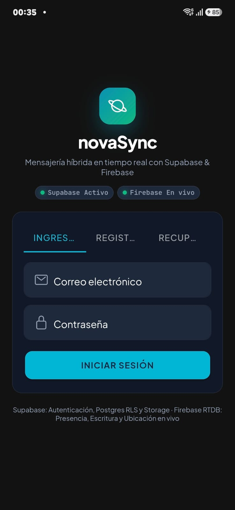 | 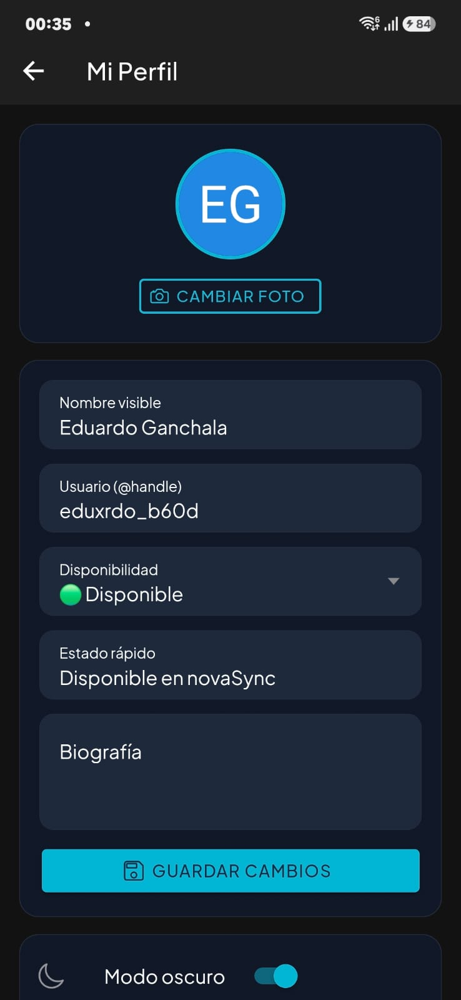 | 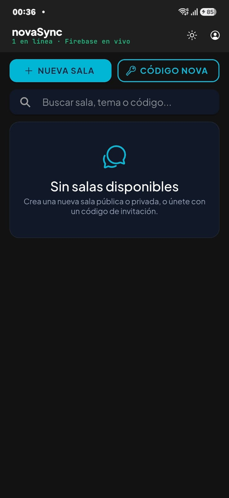 |

|                  Sala privada y código NOVA                  |                      Unirse con código                      |
| :----------------------------------------------------------: | :---------------------------------------------------------: |
| 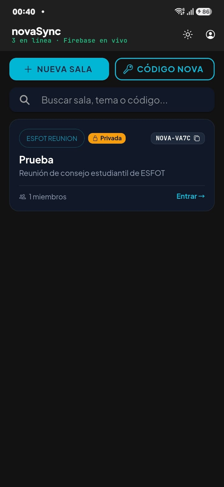 | 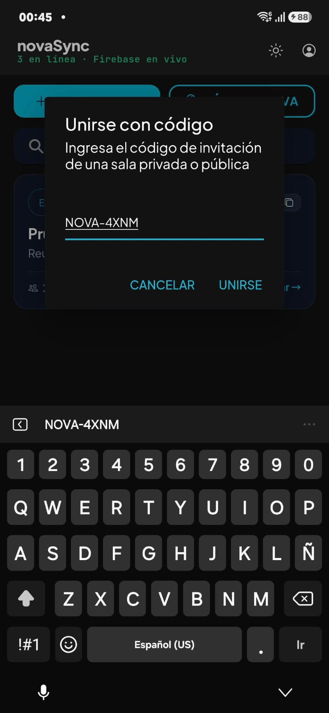 |

### Chat

|              Mensajes en tiempo real              |                   Imágenes y archivos                    |                     Respuestas, fijados y reacciones                     |
| :-----------------------------------------------: | :------------------------------------------------------: | :----------------------------------------------------------------------: |
| 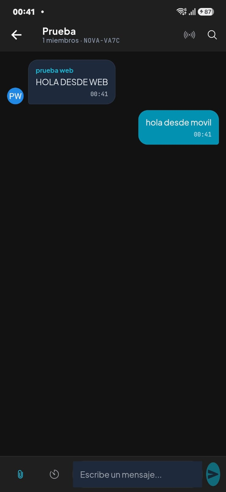 | 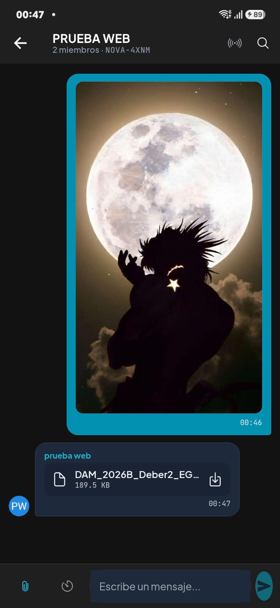 | 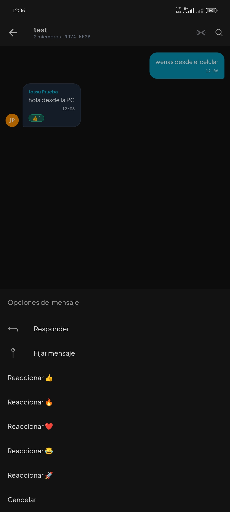 |

|                  Ubicación en mapa                  |                       Ubicación en vivo                        |                Presencia y "escribiendo..."                |                 Mensajes efímeros y modo oscuro                 |
| :-------------------------------------------------: | :------------------------------------------------------------: | :--------------------------------------------------------: | :-------------------------------------------------------------: |
| 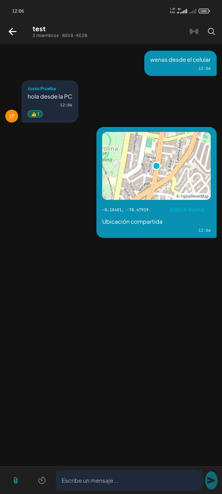 | 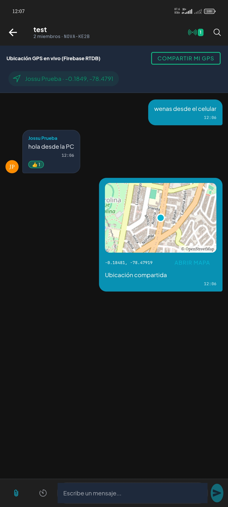 | 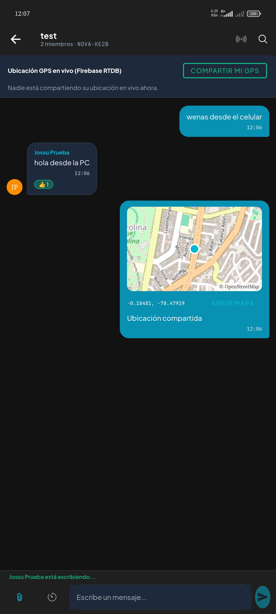 | 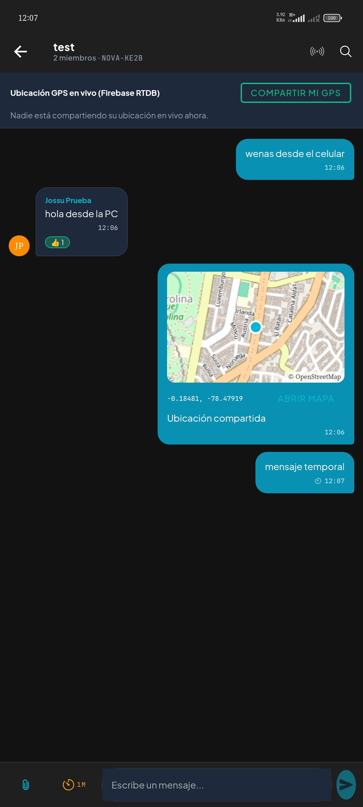 |

### Consolas de Supabase y Firebase

|                Tablas en Supabase                 |                 Storage en Supabase                 |             Realtime Database en Firebase              |
| :-----------------------------------------------: | :-------------------------------------------------: | :----------------------------------------------------: |
| 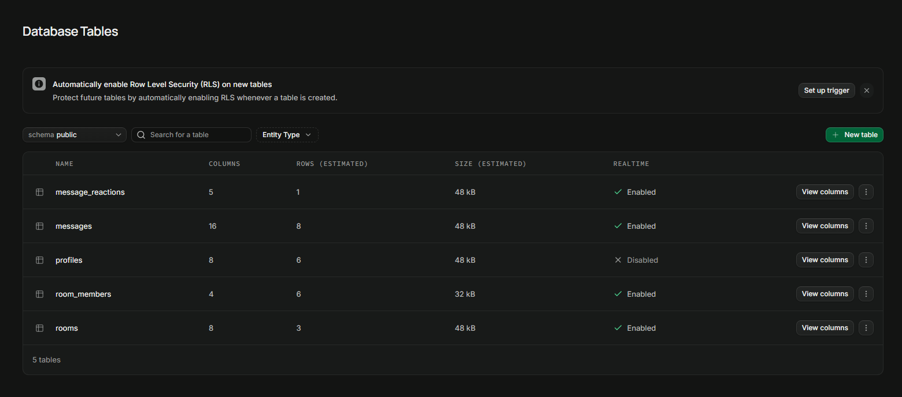 | 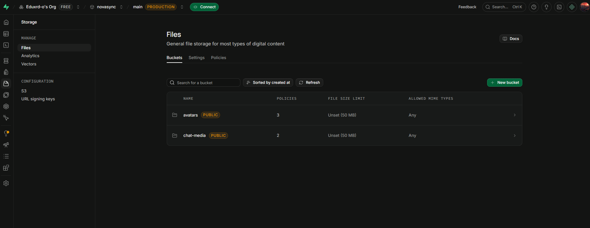 | 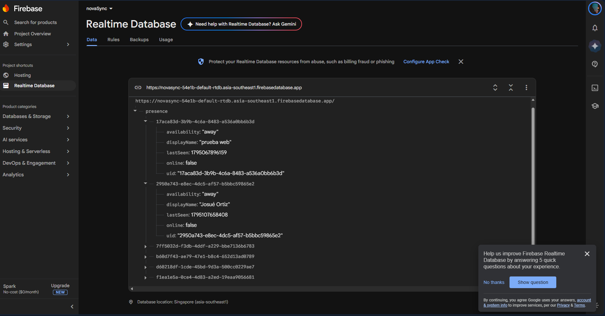 |

---

## 10. Pruebas

### Prueba en parejas

1. **Usuario A** y **Usuario B** se registran desde dispositivos distintos (navegador y APK de Android).
2. **A** edita su perfil, sube un avatar y crea una **sala privada**; comparte el código `NOVA-XXXX`.
3. **B** se une con el código, ve a **A** en línea y, cuando **A** escribe, aparece _"escribiendo..."_ en vivo.
4. Intercambian texto, una imagen, un PDF, una reacción, un mensaje fijado, un mensaje efímero de 1 minuto, una ubicación en el mapa y una **ubicación en vivo**.

### APK Resultante

> [Descargar APK](app-debug.apk)

---

## 11. Seguridad y Limitaciones

### Manejo de credenciales

- Las credenciales de Supabase y Firebase viven solo en `.env` (no versionado); `src/environments/env.config.ts` se genera en local y también está excluido en `.gitignore`. En el repositorio solo se publica [`.env.example`](./.env.example), sin valores.
- La clave **anon** de Supabase y la configuración web de Firebase **no son secretas**: terminan dentro del JavaScript publicado. La protección real depende de las políticas RLS y de las reglas de Firebase.
- La clave **`service_role`** de Supabase nunca se usa en la app ni se guarda en el repositorio, porque salta todas las políticas RLS.
- No se publican contraseñas, cuentas de servicio ni claves privadas.

### Reglas de Firebase Realtime Database

| Nodo        | Lectura | Escritura                                |
| ----------- | :-----: | ---------------------------------------- |
| `presence`  |   ✅    | ✅ en cualquier `presence/{uid}`         |
| `typing`    |   ✅    | ✅ en cualquier `typing/{roomId}/{uid}`  |
| `beacons`   |   ✅    | ✅ en cualquier `beacons/{roomId}/{uid}` |
| Otros nodos |   ❌    | ❌                                       |

Como el inicio de sesión ocurre en Supabase, Firebase no sabe quién es el usuario (`auth` es nulo) y las reglas no pueden comparar `$uid` con su identidad. Por eso, **cualquiera que conozca la URL de la base puede leer las ubicaciones en vivo y escribir la presencia de otro usuario**. Es aceptable para una práctica con datos ficticios, pero no para producción.

### Cómo se restringiría en una aplicación real

1. **Unir las identidades:** una Supabase Edge Function que emita un _custom token_ de Firebase con el mismo `uid`, para iniciar sesión en Firebase con `signInWithCustomToken`.
2. **Reglas por usuario y sala:** escribir solo en `$uid === auth.uid` y leer `typing` o `beacons` solo si se pertenece a la sala.
3. **Storage privado:** _buckets_ privados con URLs firmadas en lugar de URLs públicas.
4. **Borrado de mensajes efímeros en el servidor** con una tarea programada (`pg_cron`).
5. **Firebase App Check** y restricción de la API key por dominio o paquete.

### Limitaciones conocidas

- Los mensajes efímeros se **ocultan en el cliente** al vencer (se revisa cada 10 s), pero siguen guardados en la tabla `messages`.
- Los _buckets_ `avatars` y `chat-media` son públicos: cualquiera con el enlace puede ver la imagen o el archivo. Para subir, las políticas exigen que la carpeta sea la del propio usuario (`avatars/{uid}/…`, `chat-media/{images|files}/{uid}/…`).
- Las reacciones (`message_reactions`) son legibles por cualquier usuario autenticado, incluso las de salas privadas.
- Los avatares por defecto se generan con DiceBear (servicio externo) a partir del nombre visible.
- La carpeta `android/` no se versiona; los permisos de cámara y ubicación se agregan al generar el proyecto nativo.

---

## 12. Distribución del Trabajo

| Integrante           | Aportes                                                                                                                                                       |
| -------------------- | ------------------------------------------------------------------------------------------------------------------------------------------------------------- |
| **Ganchala Eduardo** | Creación del proyecto, arquitectura con Supabase y Firebase, esquema SQL con RLS y RPC, reglas de Realtime Database, chat y perfil.                           |
| **Ortiz Josué**      | Configuración de credenciales con `.env`, revisión de seguridad, servicios, páginas de acceso, salas, integración con el repositorio general y documentación. |
