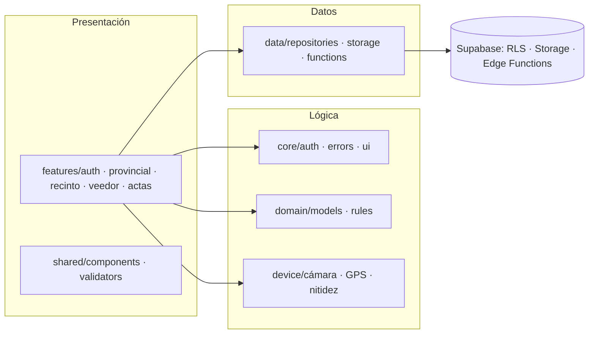
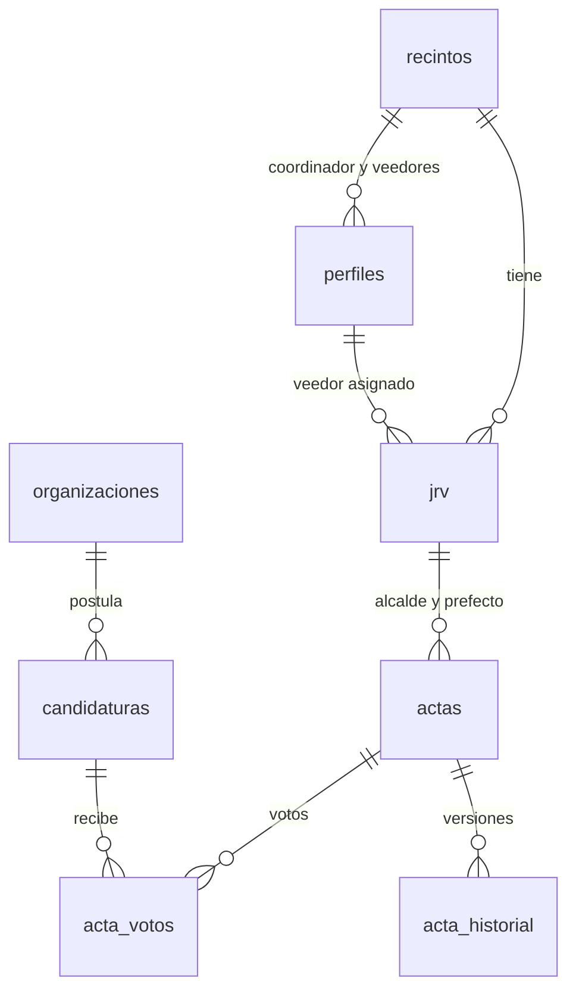

# Control Electoral — Prueba 2

Aplicación móvil para gestionar, registrar y supervisar el escrutinio electoral de una organización política en **Pichincha / Quito**:
recintos, juntas receptoras del voto (JRV), actas de alcaldía y prefectura con foto y GPS, y un dashboard consolidado.

Desarrollo de Aplicaciones Móviles · ESFOT · EPN · Periodo 2026B · **Equipo 6** (línea base común con Eduardo Ganchala) ·
desarrollo individual de **Josué Ortiz**.

- **APK:** [`app-debug.apk`](app-debug.apk)
- **ADR definitivos:** [`docs/adr/`](docs/adr/) · **Video de la deliberación:** https://youtu.be/Yn3_Y0NRamQ
- **Anexo de uso de IA:** [`docs/uso-ia.md`](docs/uso-ia.md)

---

## Tecnologías ([ADR-001](docs/adr/ADR-001-ionic-angular-standalone.md))

| Elemento | Versión |
|---|---|
| Node.js | 26.x |
| Angular / Angular CLI | 22.3 (TypeScript 6.0) |
| Ionic Angular (standalone) | 9.0 |
| Capacitor | 8.6 · `@capacitor/camera` · `@capacitor/geolocation` |
| Backend | Supabase: PostgreSQL + RLS, Auth, Storage privado, Edge Functions ([ADR-002](docs/adr/ADR-002-supabase-backend.md)) |
| Mapa | Leaflet con teselas de OpenStreetMap ([ADR-009](docs/adr/ADR-009-dashboard-vistas-openstreetmap.md)) |
| Android | Gradle 9.1, AGP 8.13, SDK 36. Terminal: JDK 21. Android Studio: su JBR. |

## Roles y funcionalidades

| Rol | Puede |
|---|---|
| Coordinador provincial (R4) | Listar y crear recintos (sus JRV se generan solas); crear y asignar un coordinador por recinto; ver avance de actas, mapa GPS y dashboard por candidato, por recinto o consolidado, con filtro para excluir actas observadas. |
| Coordinador de recinto (R5) | Ver las mesas de su recinto y su estado; crear veedores; asignar, reasignar o liberar veedores por JRV; corregir datos y fotos de actas. |
| Veedor (R6, R7) | Ver solo sus mesas; registrar y corregir actas de alcaldía y prefectura (5 organizaciones, nulos, blancos, sufragantes) con validación de totales en vivo, foto solo desde la cámara con control de nitidez y GPS como campos del registro. |

Acceso (R2, R3): sin autorregistro; login con la **cédula**; contraseña inicial `Ecuador2026` con **cambio obligatorio**;
recuperación por correo; las cuentas se crean con Edge Functions, sin claves administrativas en la app.

## Instalación y ejecución

Requisitos: Node 26, Android Studio (SDK 36) y JDK 21. **No se instala nada globalmente**: las CLIs se usan con `npx`.

```bash
npm install
cp src/environments/environment.example.ts src/environments/environment.ts
cp src/environments/environment.example.ts src/environments/environment.prod.ts   # con production: true
npx ionic serve                     # navegador
```

APK:

```bash
npx ng build && npx cap sync android
cd android && ./gradlew assembleDebug   # o abrir android/ en Android Studio
# resultado: android/app/build/outputs/apk/debug/app-debug.apk
```

## Configuración (sin secretos)

1. Crear un proyecto en Supabase (plan Free). En **Authentication → Sign In / Providers** desactivar el registro público.
2. En el **SQL Editor**, ejecutar en orden `supabase/migrations/20261125000001_esquema_inicial.sql`,
   `supabase/migrations/20261125000002_estado_mesa_guardado.sql` y `supabase/seed.sql` (datos de R1).
3. Crear el coordinador provincial en **Authentication → Users** (contraseña `Ecuador2026`, *Auto Confirm*) y ejecutar el último
   bloque de `seed.sql` con su correo.
4. Desplegar las funciones: `npx supabase login` y
   `npx supabase functions deploy crear-coordinador-recinto crear-veedor --remote=<project-ref> --use-api`.
5. Copiar la URL y la **publishable (anon) key** en `environment.ts` / `environment.prod.ts` (no versionados).

La **service_role key** solo existe como secreto de las Edge Functions; nunca está en la app ni en el repositorio.

## Arquitectura ([ADR-004](docs/adr/ADR-004-arquitectura-capas.md))



```
src/app/
├── core/       supabase (cliente), auth (servicio con signals y guardas), errors (traducción y handler global), ui (toasts)
├── domain/     models y rules (TypeScript puro: cédula, consistencia del acta)
├── data/       repositories, storage (fotos), functions (Edge Functions)
├── device/     cámara (sin galería), GPS, permisos, nitidez Laplaciana
├── shared/     <app-estado-vista>, formulario de cuentas, validadores
└── features/   auth · provincial · recinto · veedor · actas
supabase/
├── migrations/ esquema, RLS, vistas, índices y estado de mesa
└── functions/  crear-coordinador-recinto · crear-veedor
```

Solo `data/` habla con Supabase. El estado se maneja con **signals** y un tipo `Estado<T>` (cargando, vacío, error con reintento,
éxito) en todas las pantallas ([ADR-005](docs/adr/ADR-005-estado-formularios-navegacion-errores.md)). Las guardas son UX; el
control real lo hace **RLS** en el backend.

## Modelo de datos ([ADR-008](docs/adr/ADR-008-modelo-relacional-rls-storage.md))



- `actas`: totales, `foto_path` (bucket privado `actas/{recinto}/{jrv}/{dignidad}.jpg`), `lat`, `lng`, `precision_m`,
  `ubicacion_comprobable`, `estado` (VALIDADA, OBSERVADA, CORREGIDA) y `version`.
- `jrv.estado` (PENDIENTE, PARCIAL, COMPLETA, OBSERVADA) se recalcula con un trigger al registrar el acta.
- RPC `guardar_acta`: guarda acta, votos e historial en una transacción y rechaza totales inconsistentes salvo acta observada.
- Vistas con `security_invoker` para el dashboard y el avance.

## Seguridad (R8)

- Un veedor solo lee y escribe las JRV con `veedor_id = auth.uid()`; un coordinador, solo su recinto; el provincial, todo.
- Ninguna política permite operar con la contraseña inicial sin cambiar.
- Demostración: `npm run test:rls` (veedor A no lee, no se asigna ni registra en la mesa del veedor B y no puede crear
  coordinadores).

## Pruebas ([ADR-010](docs/adr/ADR-010-pruebas-errores-monitoreo.md))

| Nivel | Qué | Comando |
|---|---|---|
| 1 | Reglas del dominio (cédula, consistencia del acta, nitidez) | `npm run test:unit` |
| 2 | RLS de Supabase con las cuentas de demostración | `npm run test:rls` (requiere `.env.test`, no versionado) |
| 3 | Lista manual sobre el APK | [`docs/pruebas-manuales.md`](docs/pruebas-manuales.md) |

## Credenciales de demostración

| Rol | Cédula | Contraseña |
|---|---|---|
| Coordinador provincial | 1710034065 | [completar] |
| Coordinador de recinto | [completar] | [completar] |
| Veedor A | [completar] | [completar] |
| Veedor B | [completar] | [completar] |

Cuentas ficticias creadas solo para la demostración; las cédulas son sintéticas y válidas por módulo 10.

## Uso de IA

Ver [`docs/uso-ia.md`](docs/uso-ia.md): herramientas, consultas, qué se aceptó o descartó y cómo se validó.

---

## Autor

- **Ortiz Josué** · EPN · Periodo 2026B
